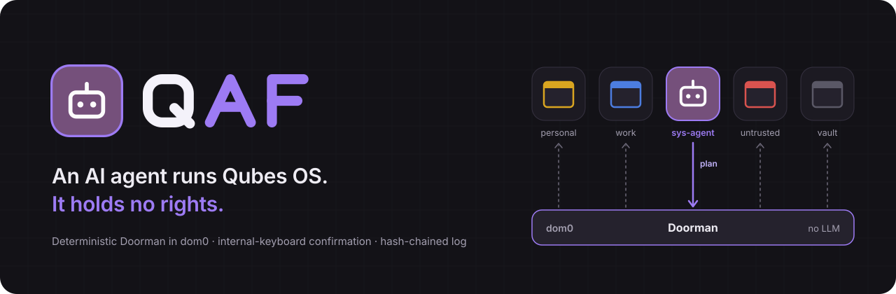

<p align="center"><a href="README.md">Français</a> · <strong>English</strong> · <a href="README.zh-CN.md">中文</a></p>

<p align="center">
  
</p>

# QAF — Qubes Agent First

**Q** for Qubes, **A** for Agent, **F** for First.

QAF is a layer on top of [Qubes OS](https://www.qubes-os.org/) 4.3. You ask in plain language ("make me a Debian dev qube with git") and an AI agent does the work: it creates and configures qubes, installs packages, runs updates, opens a file in a disposable, or steps into a qube to type there or read its screen.

The agent itself holds no rights. It lives locked inside its own qube, `sys-agent`, and all it can do is **send plans** to the **Doorman**: a deterministic program, with no LLM, installed in dom0. The Doorman validates each plan, classifies it, asks for your confirmation when needed, then has Qubes carry it out.

> An independent project, based on Qubes OS, not affiliated with the Qubes OS project.
> A prototype under active development, tested on a single machine: see [Project status](#project-status).

---

## Contents

- [The idea](#the-idea)
- [Screenshots](#screenshots)
- [Architecture](#architecture)
- [Agent providers](#agent-providers)
- [Security](#security)
- [Installation](#installation)
- [Project status](#project-status)
- [The repository](#the-repository)

## The idea

Keep power and intelligence apart.

1. **The agent can ask for anything.** No part of the OS is hidden from it.
2. **The agent holds nothing.** `sys-agent` has no `admin.*` rule: it does not talk to the Qubes Admin API. To act on the system, it has a single door: the `qaf.Plan` service.
3. **A plan is typed, never shell.** 50 operations with a closed schema (`vm.create`, `pkg.install`, `file.copy`…). One unknown field, and the whole plan is refused.
4. **The Doorman alone decides.** The severity of each operation, its provenance (has the agent read untrusted content?), the scope of your request: the strictest wins.
5. **Confirmations go through dom0.** A window the agent can neither see nor click, approved on the internal keyboard.

## Screenshots

<table>
  <tr>
    <td width="50%" valign="top"><br><sub><b>1. You ask.</b> In plain language, in the palette opened by “Ask the agent…”.</sub></td>
    <td width="50%" valign="top"><br><sub><b>2. dom0 asks you.</b> Giving the Internet to the qube the agent just created: Enter denies, A on the internal keyboard allows.</sub></td>
  </tr>
  <tr>
    <td width="50%" valign="top"><br><sub><b>3. Outside your request, it is reinforced.</b> A risky qube you did not name: a 6-digit code drawn in dom0.</sub></td>
    <td width="50%" valign="top"><br><sub><b>4. Everything is logged.</b> The <code>qaf-agent</code> panel reads the Doorman's hash-chained log; emergency pause at the bottom.</sub></td>
  </tr>
  <tr>
    <td width="50%" valign="top"><br><sub>Qubes' original Plasma desktop: QAF only adds icons to the panel, and the palette.</sub></td>
    <td width="50%" valign="top"><br><sub>The agent's card in the panel: subscription usage, sign-in (+) and console (>_).</sub></td>
  </tr>
</table>

> 01, 05 and 06: real screenshots (Qubes OS 4.3, 29 October 2026), with the interface in French. 02, 03 and 04: QAF's real windows, in English, rendered off-screen by its own code at the same screen size and laid on the background of those screenshots.

## Architecture

The agent lives in its qube. It only talks to the Doorman, and only the Doorman talks to qubesd.

<p align="center">
  
</p>

| Component | Where | Role |
|---|---|---|
| `qaf_gate/` | dom0 | **The Doorman.** qrexec stub → validator → executor, plus two helpers (`qaf-gate-taches`, `qaf-gate-outils`). This is the trusted computing base (TCB). |
| `qaf_mcp/` | sys-agent | MCP server: turns the agent's tools into typed plans sent with `qrexec-client-vm dom0 qaf.Plan`. Alongside it, the agent's **skills** (`qaf_mcp/skill/`): one base skill and seven focused ones (qubes, software, network, files and devices, upkeep, working inside a qube…) that teach it to go through the Doorman. |
| `qaf_hand/` | target qubes | **The agent's hand**, with no LLM: per-window capture, keyboard and mouse (xdotool), execution. Called by dom0 only. |
| `qaf_ui/` | dom0, graphical session | The desktop side of the agent: the confirmation window, the "Ask the agent" palette, the agent panel (`qaf-agent`), the Plasma panel icons (agent, suspension, qube icons). In French, English or Simplified Chinese, following the dom0 locale. Outside the counted TCB. |
| `policy/` | dom0 | Shipped qrexec policies (our own files, sorted before those of Qubes). |
| `tools/qaf-installer` | dom0 | One command that turns a fresh Qubes 4.3 into QAF, and `--retour` to remove everything. |

The default agent is **Claude Code**, in a pinned version installed in the `tpl-agent` template. Only one agent runs at a time: the agent card picks it among 35 providers, the full list from Omarchy's panel and launcher, a CLI installed on demand in sys-agent, an API key or a local AI. QAF never starts them without approvals: a CLI that cannot ask stays sign-in only. Claude is the only one in service. OpenRouter completed a real plan with a real key. The 12 CLIs from the launcher have only run against a fake model, without an account: the state of each one is in [docs/FOURNISSEURS.md](docs/FOURNISSEURS.md) (in French).

## Agent providers

The agent card, in the panel, offers 35 providers: Omarchy's full list. You choose, only one agent runs at a time, and Claude Code stays the default. The Doorman applies the same rules to all of them.

| Connection | Count | Providers |
|---|---:|---|
| CLI, installed on demand in sys-agent | 20 | Claude Code, Codex, Grok Build, Kimi Code, Cursor, GitHub Copilot, Muse Code, Google (Antigravity CLI), Kimchi, Hermes, Devin, Mistral Vibe, Qwen Code, OpenCode, Oh My Pi, Crush, OpenClaw, DeepSeek Harness, Kilo, Command Code |
| API key | 7 | Z.ai, Ollama Cloud, MiniMax, OpenRouter, DeepSeek, Fireworks, Synthetic |
| Local AI | 1 | Anthropic-compatible server (Ollama, LM Studio…) on a machine of yours or in another qube |
| Sign-in only, cannot become the agent | 7 | Grok Bot, Pi, Ori, MiniMax Code, Kiro CLI, Freebuff, Amp |

Sign-in only covers the CLIs whose approval step is missing or has not been observed: QAF never starts an agent in an approve-everything mode.

**Level of proof.** Claude Code is the only one in service. OpenRouter completed a real plan with a real key. Most of the others have never been used with a real account: the details, provider by provider, are in [docs/FOURNISSEURS.md](docs/FOURNISSEURS.md) (in French).

## Security

QAF starts from a simple assumption: **the agent will be manipulated one day.** It reads the Web, files, command output; some prompt injection will eventually get through. The whole model is built so that, on that day, the manipulated agent cannot do anything irreversible without you seeing it and saying yes.

### Levels N0 to N4

Every operation gets a severity level. The strictest one decides for the whole plan.

<p align="center">
  
</p>

<details>
<summary>The same table, as text</summary>

| Level | What it is | For `sys-agent` |
|---|---|---|
| **N0** | Read: list qubes, their states, updates, devices | automatic |
| **N1** | Act on what the agent created itself: create a qube (always without network), start it, delete it | automatic |
| **N2** | Act on your qubes, reversibly: start, stop, install a package, give network to one of the agent's qubes | confirmation |
| **N3** | Touch isolation: network of one of your qubes, firewall, devices, copying between qubes | reinforced confirmation |
| **N4** | Never: dom0, a vault's network or input, QAF's own infrastructure, installing a template | refused, with the reason and how to do it by hand |

</details>

`sys-agent` is a permanent agent: its memory survives from one request to the next. It is therefore **treated as influenced at all times**, hence the right-hand column. "Created by the agent" is read from the Doorman's register, never from a tag the agent could set.

**The scope of your request.** When you type a request in the palette, the executor records it itself and works out which qubes it names. An N2-or-higher action on a qube your request does not name becomes a reinforced confirmation, flagged "does not follow from your request".

### Human confirmation

- The window is drawn by **dom0**, in your session. The agent cannot see it and cannot click in it.
- It only shows the plan **re-serialized by dom0**, never the bytes the agent sent.
- **Deny** is the default (Enter). **Allow** takes the A key **on the internal keyboard**: a USB mouse or keyboard, which a qube could drive, does not count.
- For a reinforced confirmation, you also type a **6-digit code drawn at random in dom0**.
- With no answer, the window closes: that is a refusal.
- Its language is set by dom0 (the session locale), never by the agent; in English, every warning keeps exactly the same strength.

### The Doorman, in a few lines

Three processes, each with as few rights as possible:

1. **The stub** (`qaf.Plan`) reads at most 64 KiB in 10 seconds and parses nothing. It passes the raw bytes on.
2. **The validator** runs under a dedicated account, with no X, no sudo, no network and no access to qubesd (systemd sandbox). It is the only one that parses what comes from the agent. It applies the closed schema and makes a first classification.
3. **The executor** does not trust the validator: it demands an already canonical plan, byte for byte, and classifies it again; only its verdict counts. It is the only process that talks to qubesd, and it stops at the first error.

All of `qaf_gate/` stays under a **cap of 3,420 lines of code**, checked by `tools/loc.sh` and by the tests (3,386 as of 29 October 2026). Python standard library only: no pip dependency in dom0. The plan parser is fuzzed (12,000 inputs per test-suite run), and every change to `qaf_gate/` is reviewed.

### The hash-chained log

Every plan, decision, confirmation and refusal is written to `/var/lib/qaf-exec/journal.jsonl`, one JSON line per event. Each line carries the SHA-256 of the previous one: editing, deleting or reordering a line breaks the chain. On startup, the executor checks the whole chain and **refuses to append to a tampered log**. The log can be read, read-only, in the `qaf-agent` screen.

### qrexec policies

`sys-agent` is **allowlisted** (`policy/00-qaf-agent-long.policy`): `qaf.Plan` and the few standard services Qubes grants every qube (clock, icons, update notices). Everything else, towards dom0 as well as other qubes, is refused. QAF's files are sorted **before** those of Qubes (the first match wins), and the installer refuses to proceed if another file sorted ahead of them mentions the agent. The Doorman checks the caller's identity again on its side.

### dom0 is never online

dom0 has no network, as in any Qubes. Nobody, human or agent, logs into it remotely. A QAF archive only enters dom0 through `qvm-run --pass-io`, started by hand, and its SHA-256 fingerprint is compared with a value read from a source independent of the qube that downloaded it.

### Defense in depth

If one layer gives way, the next one still holds. None of them depends on the agent's goodwill.

<p align="center">
  
</p>

And an emergency stop: `sudo qaf-pause` in dom0 makes every plan refused and stops the executor between two operations.

### What QAF does not promise

- **`sys-agent` has network access** (through sys-firewall): it reads the Web and documentation. That is deliberate, since it is already treated as influenced: every N2-or-higher action will be put to you.
- **Your requests go to the model provider, unless you choose a local AI.** With a subscription or an API key, what you ask and what the agent reads go through Anthropic's servers (or another provider's). You can also choose a local AI in the agent card: a network address pointing to an Anthropic-compatible server (Ollama, LM Studio…) on a machine of yours or in another qube, and your requests no longer leave your hardware. More privacy, but a local model is usually less capable, and this path is not tested end to end yet. It is your choice: QAF's security does not depend on the model, the Doorman applies the same rules whatever it is.
- **Suspending confirmations is possible**, at your request (`qaf-suspendre 15m|1h|1j|permanent`, like Omarchy's passwordless sudo). While suspended, whatever would be confirmed goes through without a window and is logged; **N4 stays refused** and the pause takes precedence. A suspension file not owned by root, or writable by others, is ignored.
- **No external audit** has been done. The only security reviews are the project's own.

**Found a flaw?** Never in a public issue: how to report it, and what counts as one, is in [`SECURITY.md`](SECURITY.md).

## Installation

For a normally installed **Qubes OS 4.3**, with the `debian-13-xfce` template. QAF's desktop is the official KDE Plasma (X11) of Qubes (`sudo qubes-dom0-update kde-settings-qubes`), with its original Qubes menu: QAF only adds the agent pieces (panel icons, palette, agent panel, confirmation window) and no keyboard shortcut. Without Plasma, QAF still installs; the confirmation window, the palette and the agent panel also work under Xfce. Allow 20 to 40 minutes and 20 GiB free.

The screens follow the language of the dom0 session, like Plasma does (`LANGUAGE`, then `LC_ALL`, `LC_MESSAGES`, `LANG`): English when it starts with `en`, French otherwise. To switch QAF to English: Plasma System Settings, Language & Region, put English first, then log out and back in.

There is no published release yet: the `qaf.tar.gz` archive is built from this repository with `tools/make-dist.sh`, which also prints its fingerprint.

```bash
# in dom0: fetch the archive from the qube that has it, then check it
qvm-run --pass-io personal 'cat ~/Downloads/qaf.tar.gz' > ~/qaf.tar.gz
echo "FINGERPRINT  qaf.tar.gz" | sha256sum -c

# the single command
cd ~ && tar -xzf qaf.tar.gz
sudo bash qaf/tools/qaf-installer ~/qaf.tar.gz FINGERPRINT
```

The installer checks the prerequisites before changing anything, shows its plan, sets up the Doorman, creates `tpl-agent` and `sys-agent`, the working disposables and the security settings, then finishes with a non-regression check of the original Qubes. It modifies no file shipped by Qubes or KDE: it adds its own.

```bash
qaf-installer --verifier            # non-regression check of the original Qubes, read-only
sudo qaf-installer --retour         # removes everything, keeps the qubes it created
sudo qaf-installer --retour --purge # also removes the qubes it created
```

After that, one step only: connect Claude Code in `sys-agent` (the agent icon in the panel, then Claude). The full guide, the fingerprint, possible errors and removal are in [`docs/INSTALLATION.md`](docs/INSTALLATION.md) (in French).

## Project status

QAF is a **prototype**, started on 25/10/2026, developed and tried on **a single machine** (Lenovo Legion 82JU, Qubes OS 4.3.2).

**What works, tried on the real machine**:

- the full three-process Doorman, with the internal-keyboard confirmation window and the hash-chained log;
- the operations, called from `sys-agent` in plain language: creating, cloning, starting and configuring qubes, installing and removing packages, updates, backups, file copies (with Qubes' own native confirmation on top), stepping into a qube;
- the Qubes non-regression check, with the Doorman running, paused and stopped;
- the one-command installation, on a normally installed Qubes 4.3.

**Tests**: more than 3,200 automated tests (3,277 passing as of 1 November 2026), on a simulated Qubes backend. Among them, the injection suite: every plan a manipulated agent could forge ends up refused or in a dom0 window, never carried out on its own.

**Not there yet:**

- no published release or signed RPM package: an archive and its fingerprint, checked by hand;
- a single agent in service (Claude Code): apart from one real OpenRouter trial, no other provider in the card has been used with a real account;
- installing a template is still up to you, with the Qubes tool (N4);
- a single machine tried: expect surprises on another one;
- no external audit.

## The repository

Public address: <https://github.com/ponthieutheo/qaf> (`git clone https://github.com/ponthieutheo/qaf.git`).

```text
qaf_gate/    the Doorman (dom0, TCB)
qaf_mcp/     the agent's MCP server (sys-agent)
qaf_hand/    the service in target qubes
qaf_ui/      the desktop side of the agent: confirmation, palette, agent panel (dom0), French, English and Chinese
policy/      qrexec policies
packaging/   systemd units, accounts, Doorman step of qaf-installer
profil/      security settings applied by the installer
materiel/    per-machine-model profiles
tools/       qaf-installer, make-dist.sh, loc.sh
tests/       pytest suite and simulated backend
docs/        installation, troubleshooting, showcase images
```

Tests: `uv run --python 3.12 pytest -q` (on Linux or WSL). TCB size: `tools/loc.sh`.

## License

[GPL-2.0-or-later](LICENSE). Third-party material (Lucide icon paths, ISC license): [`LICENCES-TIERS`](LICENCES-TIERS).

<p align="center">
  
</p>
