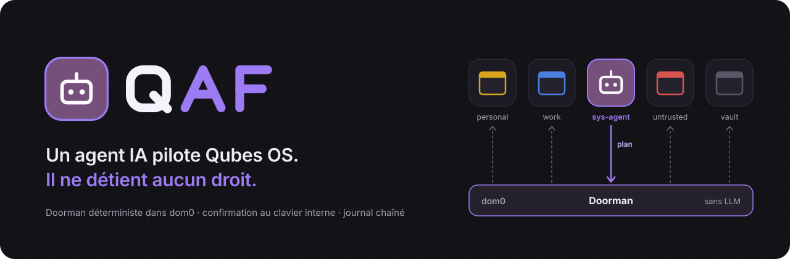
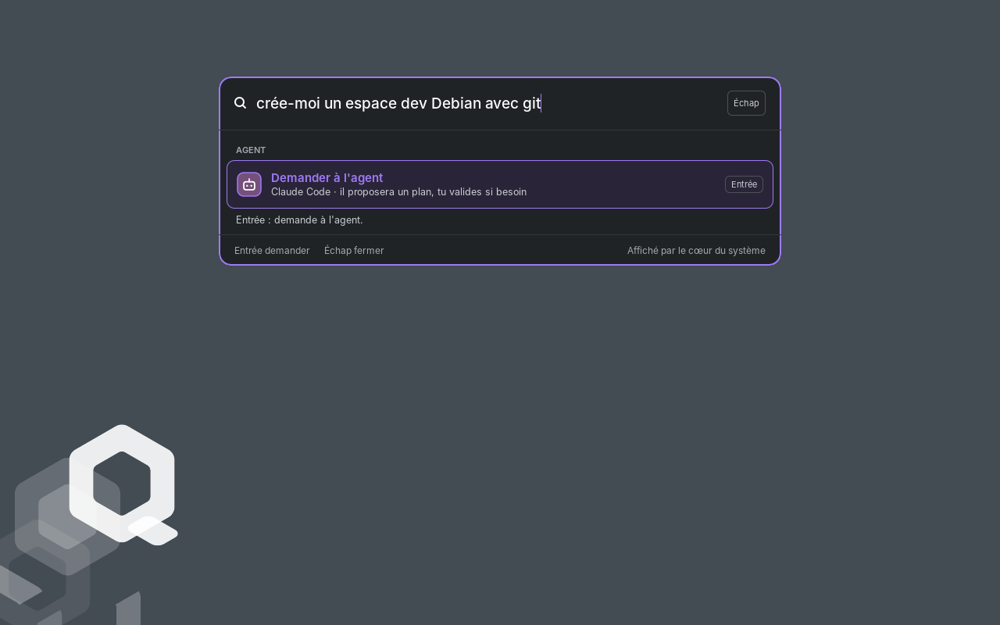
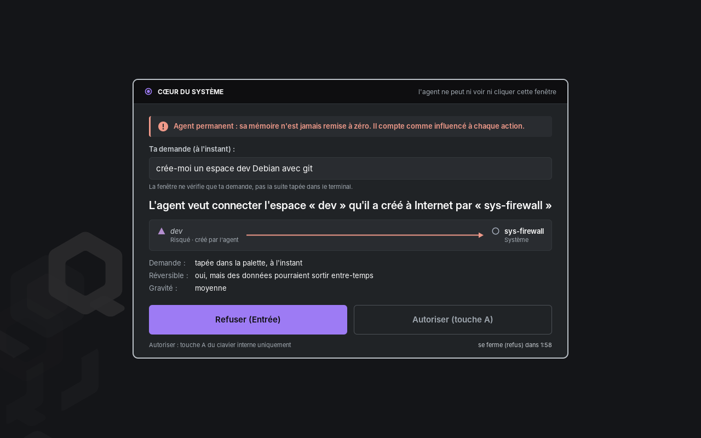
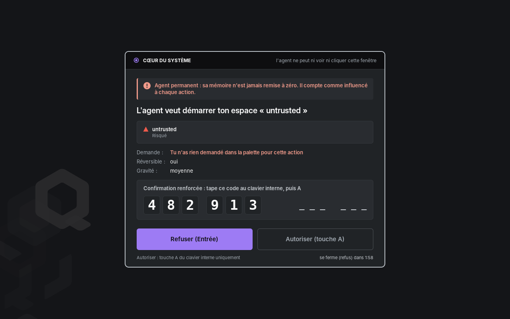
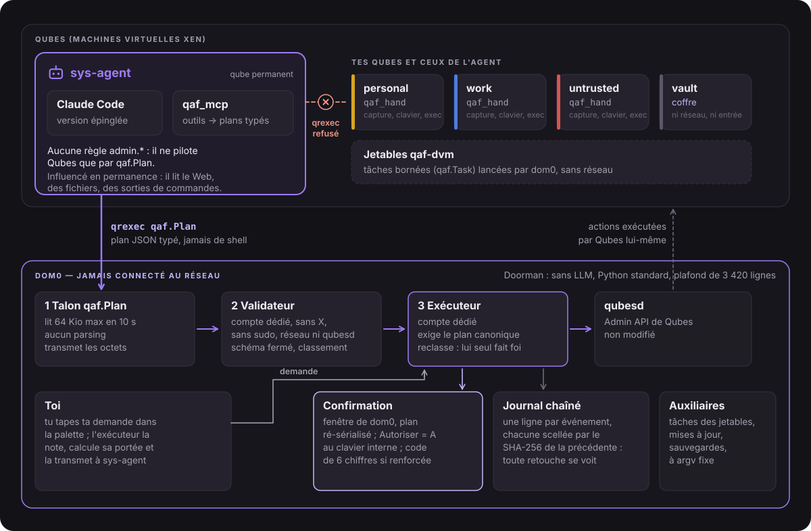
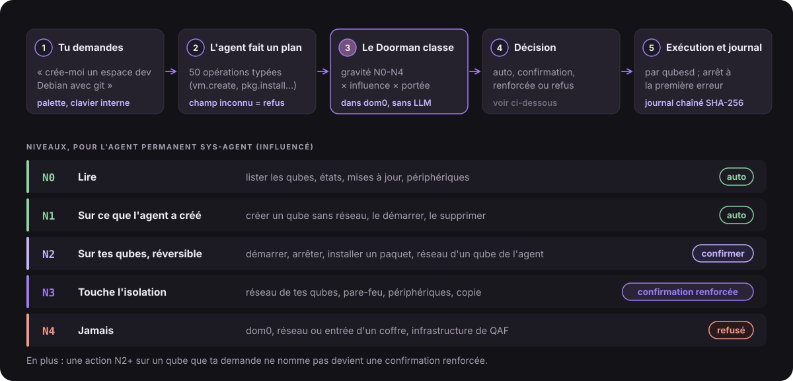
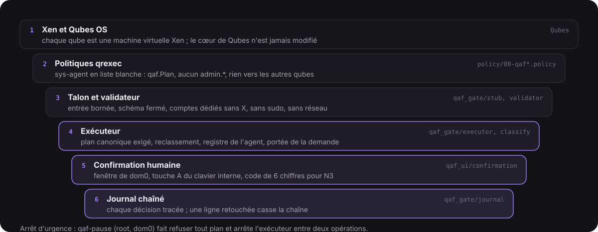

<p align="center"><strong>Français</strong> · <a href="README.en.md">English</a> · <a href="README.zh-CN.md">中文</a></p>

<p align="center">
  
</p>

# QAF — Qubes Agent First

**Q** pour Qubes, **A** pour Agent, **F** pour First.

QAF est une surcouche pour [Qubes OS](https://www.qubes-os.org/) 4.3. Tu demandes en langage naturel (« crée-moi un espace dev Debian avec git »), un agent IA fait le travail : créer et régler des qubes, installer des paquets, lancer des mises à jour, ouvrir un fichier dans un jetable, entrer dans un qube pour y taper ou y lire l'écran.

L'agent, lui, n'a aucun droit. Il vit enfermé dans son propre qube, `sys-agent`, et ne peut qu'**envoyer des plans** au **Doorman** : un programme déterministe, sans LLM, installé dans dom0. Le Doorman valide chaque plan, le classe, te demande confirmation quand il le faut, puis le fait exécuter par Qubes.

> Projet indépendant, basé sur Qubes OS, non affilié au projet Qubes OS.
> Prototype en développement actif, testé sur une seule machine : voir [État du projet](#état-du-projet).

---

## Sommaire

- [L'idée](#lidée)
- [En images](#en-images)
- [Architecture](#architecture)
- [Fournisseurs de l'agent](#fournisseurs-de-lagent)
- [Sécurité](#sécurité)
- [Installation](#installation)
- [État du projet](#état-du-projet)
- [Le dépôt](#le-dépôt)

## L'idée

Séparer le pouvoir de l'intelligence.

1. **L'agent peut tout demander.** Aucune fonction de l'OS ne lui est cachée.
2. **L'agent ne détient rien.** `sys-agent` n'a aucune règle `admin.*` : il ne parle pas à l'Admin API de Qubes. Pour agir sur le système, il n'a qu'une porte : le service `qaf.Plan`.
3. **Un plan est typé, jamais du shell.** 50 opérations à schéma fermé (`vm.create`, `pkg.install`, `file.copy`…). Un champ inconnu, et tout le plan est refusé.
4. **Le Doorman décide seul.** Gravité de chaque opération, provenance (l'agent a-t-il lu du contenu non fiable ?), portée de ta demande : le plus strict l'emporte.
5. **Les confirmations passent par dom0.** Une fenêtre que l'agent ne peut ni voir ni cliquer, validée au clavier interne.

## En images

<table>
  <tr>
    <td width="50%" valign="top"><br><sub><b>1. Tu demandes.</b> En langage naturel, dans la palette ouverte par « Demander à l'agent… ».</sub></td>
    <td width="50%" valign="top"><br><sub><b>2. dom0 te demande.</b> Donner Internet au qube que l'agent vient de créer : Entrée refuse, A au clavier interne autorise.</sub></td>
  </tr>
  <tr>
    <td width="50%" valign="top"><br><sub><b>3. Hors de ta demande, c'est renforcé.</b> Un qube risqué que tu n'as pas nommé : code de 6 chiffres tiré dans dom0.</sub></td>
    <td width="50%" valign="top"><br><sub><b>4. Tout est tracé.</b> Le panneau <code>qaf-agent</code> lit le journal chaîné du Doorman ; pause d'urgence en bas.</sub></td>
  </tr>
  <tr>
    <td width="50%" valign="top"><br><sub>Le bureau Plasma d'origine de Qubes : QAF n'y ajoute que des icônes dans la barre et la palette.</sub></td>
    <td width="50%" valign="top"><br><sub>La carte de l'agent dans la barre : usage de l'abonnement, connexion (+) et console (>_).</sub></td>
  </tr>
</table>

> 01, 05 et 06 : captures d'écran réelles (Qubes OS 4.3, 29/10/2026). 02, 03 et 04 : les vraies fenêtres de QAF, rendues hors écran par son propre code à la même taille d'écran et posées sur le fond de ces captures.

## Architecture

L'agent vit dans son qube. Il ne parle qu'au Doorman, qui seul parle à qubesd.

<p align="center">
  
</p>

| Composant | Où | Rôle |
|---|---|---|
| `qaf_gate/` | dom0 | **Le Doorman.** Talon qrexec → validateur → exécuteur, plus deux auxiliaires (`qaf-gate-taches`, `qaf-gate-outils`). C'est la base de confiance (TCB). |
| `qaf_mcp/` | sys-agent | Serveur MCP : traduit les outils de l'agent en plans typés envoyés par `qrexec-client-vm dom0 qaf.Plan`. Avec lui, les **skills** de l'agent (`qaf_mcp/skill/`) : une skill de base et sept skills ciblées (qubes, logiciels, réseau, fichiers et périphériques, entretien, travail dans un qube…) qui lui apprennent à passer par le Doorman. |
| `qaf_hand/` | qubes cibles | **La main** de l'agent, sans LLM : capture fenêtre par fenêtre, clavier et souris (xdotool), exécution. Appelé par dom0 seulement. |
| `qaf_ui/` | dom0, session graphique | La brique agent côté bureau : fenêtre de confirmation, palette « Demander à l'agent », panneau de l'agent (`qaf-agent`), icônes de la barre de Plasma (agent, suspension, icônes des qubes). En français, en anglais ou en chinois simplifié, selon la locale de dom0. Hors TCB compté. |
| `policy/` | dom0 | Politiques qrexec livrées (fichiers à nous, triés avant ceux de Qubes). |
| `tools/qaf-installer` | dom0 | Une commande qui fait d'un Qubes 4.3 neuf un QAF, et `--retour` qui retire tout. |

L'agent par défaut est **Claude Code**, dans une version épinglée installée dans le modèle `tpl-agent`. Il n'y a qu'un agent à la fois : la carte de l'agent le choisit parmi 35 fournisseurs, la liste complète du panneau et du lanceur d'Omarchy, CLI installée à la demande dans sys-agent, clé d'API ou IA locale. QAF ne les lance jamais sans validation : une CLI qui ne sait pas demander reste en connexion seule. Claude est le seul en service. OpenRouter a fait aboutir un vrai plan avec une vraie clé. Les 12 CLI venues du lanceur n'ont tourné que contre un faux modèle, sans compte : l'état de chacun est dans [docs/FOURNISSEURS.md](docs/FOURNISSEURS.md).

## Fournisseurs de l'agent

La carte de l'agent, dans la barre, propose 35 fournisseurs : la liste complète d'Omarchy. Tu choisis, un seul agent tourne à la fois, et Claude Code reste le choix par défaut. Le Doorman applique les mêmes règles à tous.

| Connexion | Nombre | Fournisseurs |
|---|---:|---|
| CLI, installée à la demande dans sys-agent | 20 | Claude Code, Codex, Grok Build, Kimi Code, Cursor, GitHub Copilot, Muse Code, Google (Antigravity CLI), Kimchi, Hermes, Devin, Mistral Vibe, Qwen Code, OpenCode, Oh My Pi, Crush, OpenClaw, DeepSeek Harness, Kilo, Command Code |
| Clé d'API | 7 | Z.ai, Ollama Cloud, MiniMax, OpenRouter, DeepSeek, Fireworks, Synthetic |
| IA locale | 1 | Serveur compatible Anthropic (Ollama, LM Studio…) sur un poste à toi ou dans un autre qube |
| Connexion seule, ne peut pas devenir l'agent | 7 | Grok Bot, Pi, Ori, MiniMax Code, Kiro CLI, Freebuff, Amp |

La connexion seule concerne les CLI dont la validation est absente ou n'a pas été vue : QAF ne lance aucun agent en mode « tout passe ».

**Niveau de preuve.** Claude Code est le seul en service. OpenRouter a fait aboutir un vrai plan avec une vraie clé. La plupart des autres n'ont jamais servi avec un vrai compte : le détail, fournisseur par fournisseur, est dans [docs/FOURNISSEURS.md](docs/FOURNISSEURS.md).

## Sécurité

QAF part d'une hypothèse simple : **l'agent sera un jour manipulé.** Il lit le Web, des fichiers, des sorties de commandes ; une injection de prompt finira par passer. Tout le modèle vise à ce que ce jour-là, l'agent manipulé ne puisse rien faire d'irréversible sans que tu le voies et que tu dises oui.

### Niveaux N0 à N4

Chaque opération reçoit un niveau de gravité. Le plus strict décide pour tout le plan.

<p align="center">
  
</p>

<details>
<summary>Le même tableau, en texte</summary>

| Niveau | Ce que c'est | Pour `sys-agent` |
|---|---|---|
| **N0** | Lire : lister les qubes, leurs états, les mises à jour, les périphériques | automatique |
| **N1** | Agir sur ce que l'agent a lui-même créé : créer un qube (toujours sans réseau), le démarrer, le supprimer | automatique |
| **N2** | Agir sur tes qubes, de façon réversible : démarrer, arrêter, installer un paquet, donner le réseau à un qube de l'agent | confirmation |
| **N3** | Toucher l'isolation : réseau d'un de tes qubes, pare-feu, périphériques, copie entre qubes | confirmation renforcée |
| **N4** | Jamais : dom0, réseau ou entrée d'un coffre, l'infrastructure de QAF, installer un modèle | refus, avec le motif et la marche à suivre à la main |

</details>

`sys-agent` est un agent permanent : sa mémoire survit d'une demande à l'autre. Il est donc **traité comme influencé en permanence**, d'où la colonne de droite. « Créé par l'agent » se lit dans le registre du Doorman, jamais dans une étiquette que l'agent pourrait poser.

**La portée de ta demande.** Quand tu tapes une demande dans la palette, l'exécuteur la note lui-même et en tire les qubes qu'elle nomme. Une action N2 ou plus sur un qube que ta demande ne nomme pas passe en confirmation renforcée, avec la mention « ne découle pas de ta demande ».

### La confirmation humaine

- La fenêtre est dessinée par **dom0**, dans ta session. L'agent ne la voit pas et ne peut pas cliquer dedans.
- Elle n'affiche que le plan **ré-sérialisé par dom0**, jamais les octets envoyés par l'agent.
- **Refuser** est le choix par défaut (Entrée). **Autoriser** se fait par la touche A **du clavier interne** : une souris ou un clavier USB, qu'un qube pourrait piloter, ne compte pas.
- Pour une confirmation renforcée, tu retapes en plus un **code de 6 chiffres tiré au hasard dans dom0**.
- Sans réponse, la fenêtre se ferme : c'est un refus.
- Sa langue est fixée par dom0 (la locale de la session), jamais par l'agent ; en anglais, chaque avertissement garde exactement la même force.

### Le Doorman, en quelques lignes

Trois processus, chacun avec le moins de droits possible :

1. **Le talon** (`qaf.Plan`) lit au plus 64 Kio en 10 secondes et ne parse rien. Il transmet les octets bruts.
2. **Le validateur** tourne sous un compte dédié, sans X, sans sudo, sans réseau, sans accès à qubesd (sandbox systemd). C'est le seul à parser ce qui vient de l'agent. Il applique le schéma fermé et fait un premier classement.
3. **L'exécuteur** ne fait pas confiance au validateur : il exige un plan déjà canonique, octet pour octet, et refait le classement, qui seul fait foi. C'est le seul processus qui parle à qubesd, et il s'arrête à la première erreur.

Tout `qaf_gate/` tient sous un **plafond de 3 420 lignes de code**, vérifié par `tools/loc.sh` et par les tests (3 386 au 29/10/2026). Bibliothèque standard Python uniquement : aucune dépendance pip dans dom0. Le parseur de plans est fuzzé (12 000 entrées par passage de la suite de tests), et chaque modification de `qaf_gate/` est relue.

### Le journal chaîné

Chaque plan, décision, confirmation et refus est écrit dans `/var/lib/qaf-exec/journal.jsonl`, une ligne JSON par événement. Chaque ligne porte le SHA-256 de la précédente : modifier, supprimer ou réordonner une ligne casse la chaîne. Au démarrage, l'exécuteur vérifie toute la chaîne et **refuse d'écrire à la suite d'un journal altéré**. Le journal se lit dans l'écran `qaf-agent`, en lecture seule.

### Les politiques qrexec

`sys-agent` est en **liste blanche** (`policy/00-qaf-agent-long.policy`) : `qaf.Plan` et les quelques services standard que Qubes accorde à tout qube (horloge, icônes, avis de mises à jour). Tout le reste, vers dom0 comme vers les autres qubes, est refusé. Les fichiers de QAF sont triés **avant** ceux de Qubes (le premier qui correspond l'emporte), et l'installateur refuse de s'installer si un autre fichier trié avant eux parle de l'agent. Le Doorman revérifie de son côté l'identité de l'appelant.

### dom0 n'est jamais connecté

dom0 n'a pas de réseau, comme dans tout Qubes. Personne, ni humain ni agent, ne s'y connecte à distance. Une archive QAF n'entre dans dom0 que par `qvm-run --pass-io`, lancé à la main, et son empreinte SHA-256 est comparée à une valeur lue sur une source indépendante du qube qui l'a téléchargée.

### Défense en profondeur

Si une couche cède, la suivante tient encore. Aucune ne dépend du bon vouloir de l'agent.

<p align="center">
  
</p>

Et un arrêt d'urgence : `sudo qaf-pause` dans dom0 fait refuser tout plan et arrête l'exécuteur entre deux opérations.

### Ce que QAF ne promet pas

- **`sys-agent` a le réseau** (par sys-firewall) : il lit le Web et la documentation. C'est assumé, puisqu'il est déjà traité comme influencé : toute action N2 ou plus te sera demandée.
- **Tes demandes partent chez le fournisseur du modèle, sauf si tu choisis une IA locale.** Avec un abonnement ou une clé d'API, ce que tu demandes et ce que l'agent lit passent par les serveurs d'Anthropic (ou d'un autre fournisseur). Tu peux aussi choisir une IA locale dans la carte de l'agent : une adresse réseau vers un serveur compatible Anthropic (Ollama, LM Studio…) sur un poste à toi ou dans un autre qube, et tes demandes ne sortent plus de chez toi. Plus de confidentialité, mais un modèle local est en général moins capable, et cette voie n'est pas encore testée de bout en bout. C'est ton choix : la sécurité de QAF ne dépend pas du modèle, le Doorman applique les mêmes règles quel qu'il soit.
- **Suspendre les confirmations est possible**, à ta demande (`qaf-suspendre 15m|1h|1j|permanent`, comme le sudo sans mot de passe d'Omarchy). Pendant la suspension, ce qui serait confirmé passe sans fenêtre, noté au journal ; **N4 reste refusé** et la pause l'emporte. Un fichier de suspension qui n'appartient pas à root, ou modifiable par d'autres, est ignoré.
- **Aucun audit externe** n'a été fait. Les seules revues de sécurité sont celles du projet.

**Une faille ?** Jamais dans un ticket public : la marche à suivre et ce qui compte comme faille sont dans [`SECURITY.md`](SECURITY.md).

## Installation

Pour un **Qubes OS 4.3** installé normalement, avec le modèle `debian-13-xfce`. Le bureau de QAF est le KDE Plasma (X11) officiel de Qubes (`sudo qubes-dom0-update kde-settings-qubes`), avec son menu Qubes d'origine : QAF n'y ajoute que la brique agent (icônes de la barre, palette, panneau de l'agent, fenêtre de confirmation) et aucun raccourci clavier. Sans Plasma, QAF s'installe quand même ; la fenêtre de confirmation, la palette et le panneau de l'agent marchent aussi sous Xfce. Compter 20 à 40 minutes et 20 Gio libres.

Les écrans suivent la langue de la session de dom0, comme Plasma (`LANGUAGE`, puis `LC_ALL`, `LC_MESSAGES`, `LANG`) : anglais si elle commence par `en`, français sinon. Pour passer QAF en anglais : Réglages du système de Plasma, Langue et région, mettre l'anglais en tête, puis se déconnecter et se reconnecter.

Il n'y a pas encore de version publiée : l'archive `qaf.tar.gz` se construit depuis ce dépôt avec `tools/make-dist.sh`, qui affiche aussi son empreinte.

```bash
# dans dom0 : amener l'archive depuis le qube qui l'a, puis la vérifier
qvm-run --pass-io personal 'cat ~/Downloads/qaf.tar.gz' > ~/qaf.tar.gz
echo "EMPREINTE  qaf.tar.gz" | sha256sum -c

# la commande unique
cd ~ && tar -xzf qaf.tar.gz
sudo bash qaf/tools/qaf-installer ~/qaf.tar.gz EMPREINTE
```

L'installateur contrôle les prérequis avant de rien changer, affiche son plan, pose le Doorman, crée `tpl-agent` et `sys-agent`, les jetables de travail, les réglages de sécurité, puis termine par un contrôle de non-régression du Qubes d'origine. Il ne modifie aucun fichier livré par Qubes ou par KDE : il ajoute les siens.

```bash
qaf-installer --verifier            # non-régression du Qubes d'origine, lecture seule
sudo qaf-installer --retour         # retire tout, garde les qubes créés
sudo qaf-installer --retour --purge # retire aussi les qubes créés
```

Ensuite, une seule étape : connecter Claude Code dans `sys-agent` (icône de l'agent dans la barre, puis Claude). Le mode d'emploi complet, l'empreinte, les erreurs possibles et le retrait sont dans [`docs/INSTALLATION.md`](docs/INSTALLATION.md).

## État du projet

QAF est un **prototype**, commencé le 25/10/2026, développé et essayé sur **une seule machine** (Lenovo Legion 82JU, Qubes OS 4.3.2).

**Ce qui marche, essayé sur la machine réelle** :

- le Doorman complet en trois processus, avec la fenêtre de confirmation au clavier interne et le journal chaîné ;
- les opérations, appelées depuis `sys-agent` en langage naturel : créer, cloner, démarrer, régler des qubes, installer et retirer des paquets, mises à jour, sauvegardes, copie de fichiers (avec la confirmation native de Qubes en plus), entrée dans un qube ;
- le contrôle de non-régression de Qubes, Doorman en marche, en pause et arrêté ;
- l'installation en une commande, sur un Qubes 4.3 installé normalement.

**Tests** : plus de 3 200 tests automatisés (3 277 réussis au 01/11/2026), sur un backend Qubes simulé. Parmi eux, la suite des injections : chaque plan qu'un agent manipulé pourrait forger finit refusé ou dans une fenêtre de dom0, jamais exécuté d'office.

**Pas encore là :**

- pas de version publiée ni de paquet RPM signé : une archive et son empreinte, vérifiée à la main ;
- un seul agent en service (Claude Code) : hors un essai réel d'OpenRouter, aucun autre fournisseur de la carte n'a servi avec un vrai compte ;
- l'installation d'un modèle reste à faire toi-même, avec l'outil de Qubes (N4) ;
- une seule machine essayée : sur une autre, attends-toi à des surprises ;
- aucun audit externe.

## Le dépôt

Adresse publique : <https://github.com/ponthieutheo/qaf> (`git clone https://github.com/ponthieutheo/qaf.git`).

```text
qaf_gate/    le Doorman (dom0, TCB)
qaf_mcp/     serveur MCP de l'agent (sys-agent)
qaf_hand/    service des qubes cibles
qaf_ui/      brique agent du bureau : confirmation, palette, panneau de l'agent (dom0), en français, en anglais et en chinois
policy/      politiques qrexec
packaging/   unités systemd, comptes, étape Doorman de qaf-installer
profil/      réglages de sécurité posés par l'installateur
materiel/    profils par modèle de machine
tools/       qaf-installer, make-dist.sh, loc.sh
tests/       suite pytest et backend simulé
docs/        installation, dépannage, images de la vitrine
```

Tests : `uv run --python 3.12 pytest -q` (sous Linux ou WSL). Taille de la TCB : `tools/loc.sh`.

## Licence

[GPL-2.0-or-later](LICENSE). Éléments repris de projets tiers (tracés d'icônes de Lucide, licence ISC) : [`LICENCES-TIERS`](LICENCES-TIERS).

<p align="center">
  
</p>
