<p align="center"><a href="README.md">Français</a> · <a href="README.en.md">English</a> · <strong>中文</strong></p>

<p align="center">
  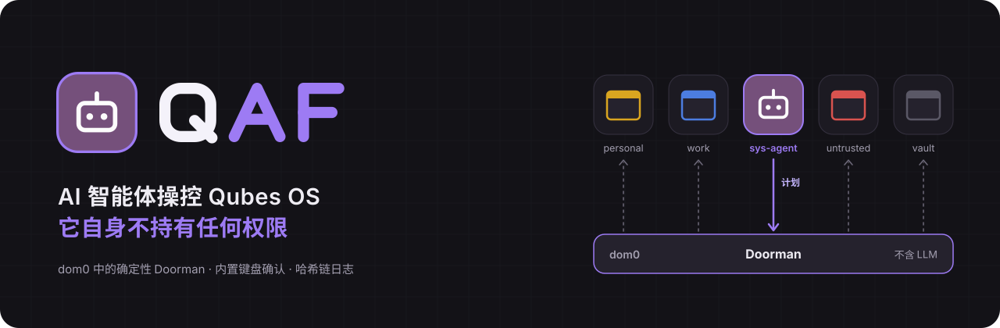
</p>

# QAF — Qubes Agent First

**Q** 代表 Qubes，**A** 代表 Agent（智能体），**F** 代表 First（优先）。

QAF 是 [Qubes OS](https://www.qubes-os.org/) 4.3 之上的一层扩展。你用自然语言提出请求（“给我建一个装好 git 的 Debian dev qube”），由一个 AI 智能体完成工作：创建和设置 qube、安装软件包、运行更新、在一次性 qube 中打开文件、进入某个 qube 在里面输入或读取屏幕。

而智能体本身没有任何权限。它被关在自己的 qube `sys-agent` 里，唯一能做的就是**把计划发给 Doorman**：一个安装在 dom0 中、不含 LLM 的确定性程序。Doorman 校验每个计划，给它定级，必要时请你确认，然后交给 Qubes 执行。

> 独立项目，基于 Qubes OS，与 Qubes OS 项目无隶属关系。
> 原型，正在积极开发，只在一台机器上测试过：见[项目状态](#项目状态)。

---

## 目录

- [思路](#思路)
- [截图](#截图)
- [架构](#架构)
- [安全](#安全)
- [安装](#安装)
- [项目状态](#项目状态)
- [代码仓库](#代码仓库)

## 思路

把权力和智能分开。

1. **智能体什么都可以请求。** 操作系统的任何功能都不对它隐藏。
2. **智能体什么都不持有。** `sys-agent` 没有任何 `admin.*` 规则：它不与 Qubes 的 Admin API 通信。要对系统做任何事，它只有一扇门：`qaf.Plan` 服务。
3. **计划是有类型的，绝不是 shell。** 50 种采用封闭模式的操作（`vm.create`、`pkg.install`、`file.copy`……）。只要出现一个未知字段，整个计划都会被拒绝。
4. **由 Doorman 独自决定。** 每项操作的严重程度、来源（智能体是否读过不可信的内容？）、你的请求的范围：取其中最严格的。
5. **确认经由 dom0。** 一个智能体既看不到也点不到的窗口，用内置键盘确认。

## 截图

<table>
  <tr>
    <td width="50%" valign="top">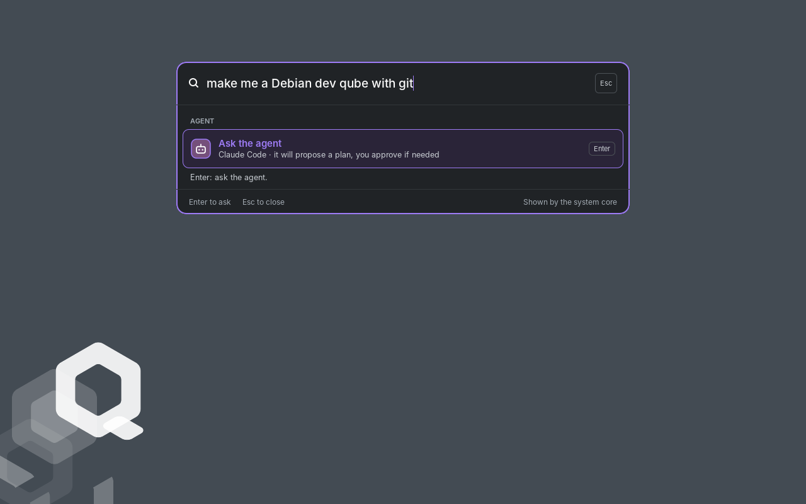<br><sub><b>1. 你提出请求。</b> 用自然语言，在“向智能体提问…”打开的提问框里。</sub></td>
    <td width="50%" valign="top">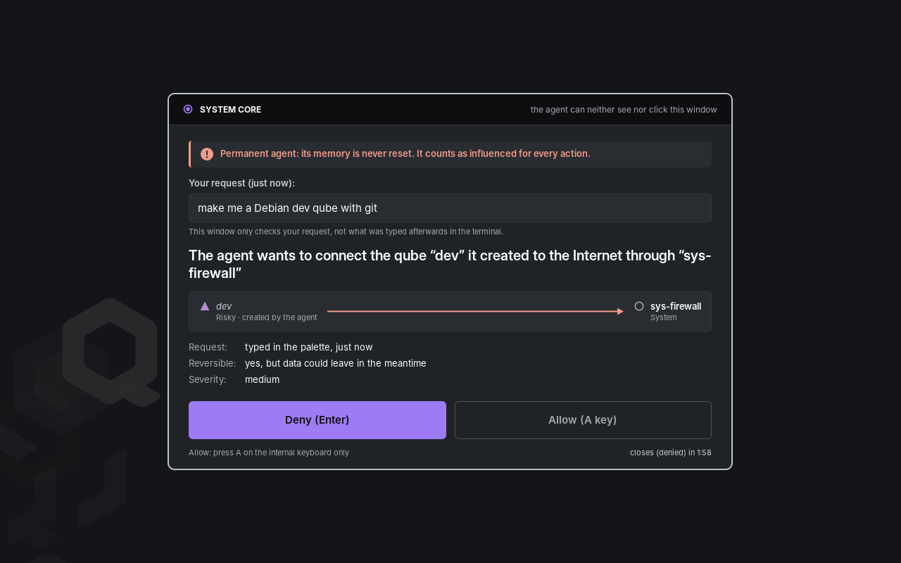<br><sub><b>2. dom0 来问你。</b> 让智能体刚创建的 qube 联网：Enter 拒绝，内置键盘上的 A 键允许。</sub></td>
  </tr>
  <tr>
    <td width="50%" valign="top">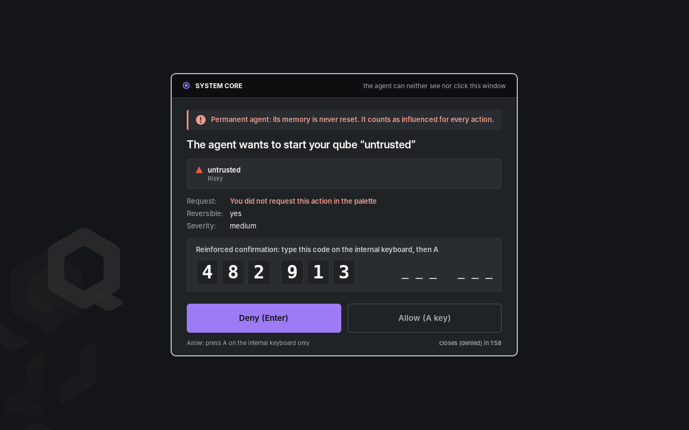<br><sub><b>3. 超出你的请求，就要加强确认。</b> 一个你没有提到的高风险 qube：需输入 dom0 生成的 6 位确认码。</sub></td>
    <td width="50%" valign="top">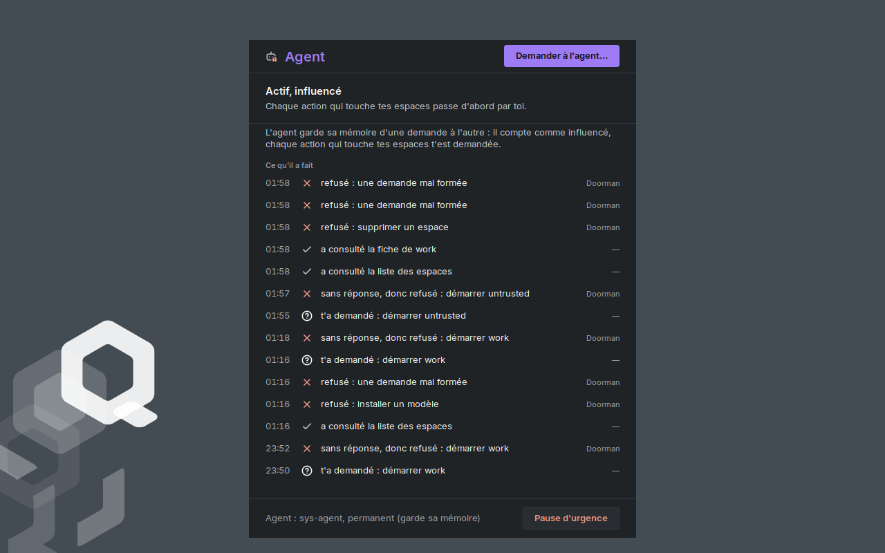<br><sub><b>4. 一切都有记录。</b> <code>qaf-agent</code> 面板读取 Doorman 的哈希链日志；底部是紧急暂停。</sub></td>
  </tr>
  <tr>
    <td width="50%" valign="top">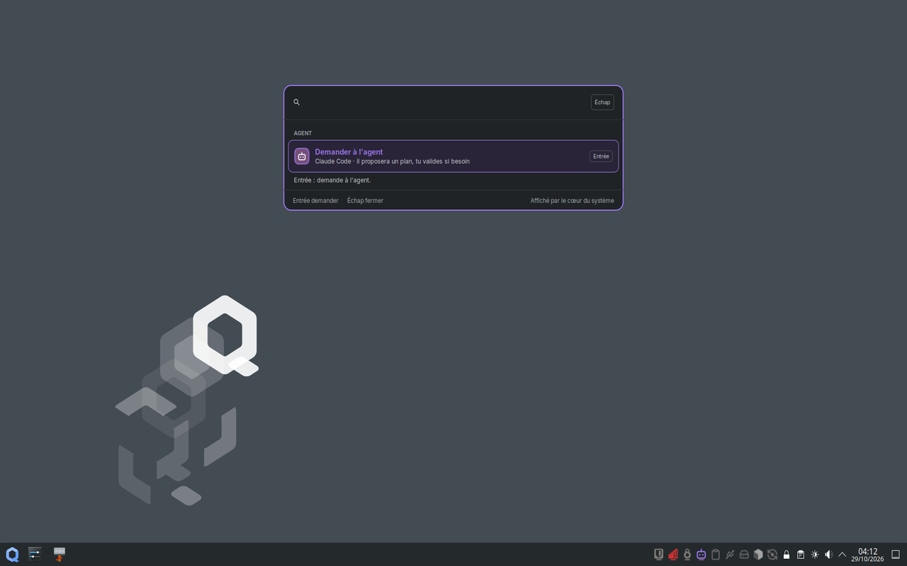<br><sub>Qubes 原有的 Plasma 桌面：QAF 只在其中加入任务栏图标和提问框。</sub></td>
    <td width="50%" valign="top">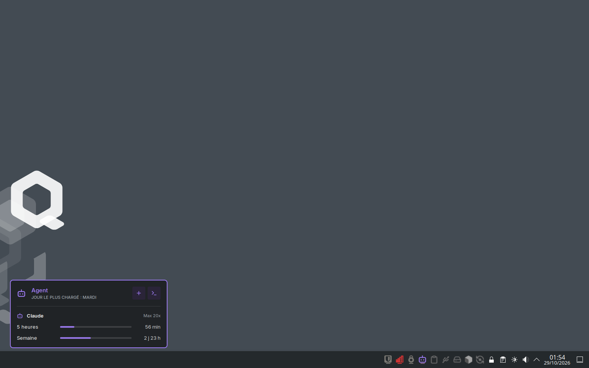<br><sub>任务栏中的智能体卡片：订阅用量、连接（+）和控制台（>_）。</sub></td>
  </tr>
</table>

> 01、05 和 06：真实截图（Qubes OS 4.3，2026/10/29），界面为法语。02、03 和 04：QAF 的真实窗口，界面为英语，由它自己的代码在同样的屏幕尺寸下离屏渲染，并叠放在这些截图的背景上。

## 架构

智能体住在自己的 qube 里。它只与 Doorman 对话，而只有 Doorman 与 qubesd 对话。

<p align="center">
  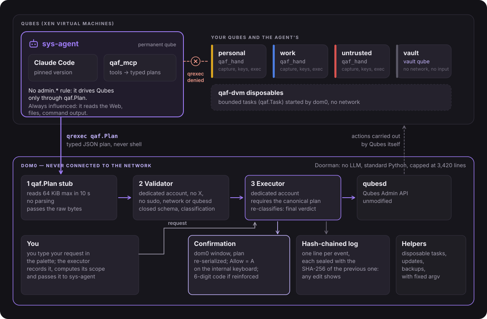
</p>

| 组件 | 位置 | 作用 |
|---|---|---|
| `qaf_gate/` | dom0 | **Doorman。** qrexec 存根 → 校验器 → 执行器，外加两个辅助进程（`qaf-gate-taches`、`qaf-gate-outils`）。这是可信计算基（TCB）。 |
| `qaf_mcp/` | sys-agent | MCP 服务器：把智能体的工具翻译成有类型的计划，通过 `qrexec-client-vm dom0 qaf.Plan` 发送。与它一起的还有智能体的 **skills**（`qaf_mcp/skill/`）：一个基础 skill 和七个专项 skill（qube、软件、网络、文件和设备、维护、在 qube 中工作……），教它通过 Doorman 来做事。 |
| `qaf_hand/` | 目标 qube | 智能体的**手**，不含 LLM：逐个窗口截图、键盘和鼠标（xdotool）、执行命令。只由 dom0 调用。 |
| `qaf_ui/` | dom0，图形会话 | 桌面上的智能体组件：确认窗口、“向智能体提问”提问框、智能体面板（`qaf-agent`）、Plasma 任务栏图标（智能体、免确认、各 qube 的图标）。按 dom0 的区域设置显示法语、英语或简体中文。不计入 TCB。 |
| `policy/` | dom0 | 随附的 qrexec 策略（我们自己的文件，排在 Qubes 的文件之前）。 |
| `tools/qaf-installer` | dom0 | 一条命令把全新的 Qubes 4.3 变成 QAF，`--retour` 则把一切移除。 |

目前的智能体是 **Claude Code**，固定版本，安装在模板 `tpl-agent` 中。接口约定（一个 MCP 服务器和一个 skill）也为其他 CLI 预留。

## 安全

QAF 的出发点很简单：**智能体总有一天会被操纵。** 它读网页、读文件、读命令输出；提示注入迟早会得逞。整个模型的目标是：到了那一天，被操纵的智能体在你没看到、没同意之前，做不了任何不可撤销的事。

### N0 到 N4 级

每项操作都有一个严重级别。由最严格的那一项决定整个计划。

<p align="center">
  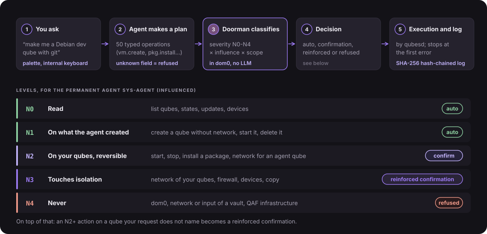
</p>

<details>
<summary>同一张表，文字版</summary>

| 级别 | 含义 | 对 `sys-agent` |
|---|---|---|
| **N0** | 读取：列出 qube、它们的状态、更新、设备 | 自动 |
| **N1** | 操作智能体自己创建的东西：创建 qube（始终不联网）、启动、删除 | 自动 |
| **N2** | 以可撤销的方式操作你的 qube：启动、关闭、安装软件包、让智能体的某个 qube 联网 | 确认 |
| **N3** | 触及隔离：你的某个 qube 的网络、防火墙、设备、qube 之间的复制 | 加强确认 |
| **N4** | 永不：dom0、保险库的网络或输入、QAF 的基础设施、安装模板 | 拒绝，并给出原因和手动操作的步骤 |

</details>

`sys-agent` 是常驻智能体：它的记忆在一次次请求之间保留下来。因此它**始终被当作“受影响”对待**，这就是右边那一列的由来。“由智能体创建”是从 Doorman 的登记簿中读取的，绝不取自智能体能自己贴上的标签。

**你的请求的范围。** 你在提问框中输入请求时，执行器会自己记下它，并从中找出它提到的 qube。对你的请求没有提到的 qube 执行 N2 及以上的操作，会升级为加强确认，并标注“并非出自你的请求”。

### 人工确认

- 窗口由 **dom0** 在你的会话中绘制。智能体看不到它，也无法在里面点击。
- 它只显示**由 dom0 重新序列化**的计划，绝不显示智能体发来的原始字节。
- **拒绝**是默认选项（Enter）。**允许**只能用**内置键盘**上的 A 键：鼠标或 USB 键盘可能被某个 qube 操控，一律不算。
- 加强确认时，你还要再输入一个**在 dom0 中随机生成的 6 位确认码**。
- 无人回答时窗口会关闭：这就是拒绝。
- 它的语言由 dom0（会话的区域设置）决定，绝不由智能体决定；在英语和中文里，每一条警告都保持与法语完全相同的力度。

### Doorman 简述

三个进程，每个都只有尽可能少的权限：

1. **存根**（`qaf.Plan`）在 10 秒内最多读取 64 KiB，不做任何解析。它只转发原始字节。
2. **校验器**在专用账户下运行，没有 X、没有 sudo、没有网络，也无法访问 qubesd（systemd 沙箱）。它是唯一解析智能体发来内容的进程。它执行封闭模式并做初步定级。
3. **执行器**不信任校验器：它要求计划已经是规范形式，逐字节一致，并重新定级，只有它的定级才算数。它是唯一与 qubesd 通信的进程，遇到第一个错误就停止。

整个 `qaf_gate/` 控制在 **3 420 行代码的上限**之内，由 `tools/loc.sh` 和测试检查（2026/10/29 为 3 386 行）。只用 Python 标准库：dom0 中没有任何 pip 依赖。计划解析器经过模糊测试（测试套件每运行一次 12 000 个输入），`qaf_gate/` 的每一处修改都经过审阅。

### 哈希链日志

每个计划、决定、确认和拒绝都写入 `/var/lib/qaf-exec/journal.jsonl`，每个事件一行 JSON。每一行都带有上一行的 SHA-256：修改、删除或调换任何一行都会破坏这条链。启动时，执行器校验整条链，并**拒绝在被篡改的日志后面继续写入**。日志可以在 `qaf-agent` 界面中以只读方式查看。

### qrexec 策略

`sys-agent` 采用**白名单**（`policy/00-qaf-agent-long.policy`）：`qaf.Plan`，以及 Qubes 给所有 qube 的少数几个标准服务（时钟、图标、更新通知）。其余一切，无论发往 dom0 还是其他 qube，都被拒绝。QAF 的文件排在 Qubes 的文件**之前**（第一条匹配的规则生效），如果有别的文件排在它们之前并且涉及智能体，安装程序会拒绝安装。Doorman 自己还会再核实调用者的身份。

### dom0 从不联网

和所有 Qubes 一样，dom0 没有网络。任何人，无论人还是智能体，都不远程登录它。QAF 的归档只能通过手动运行的 `qvm-run --pass-io` 进入 dom0，其 SHA-256 指纹要与从独立于下载它的那个 qube 的来源读到的值进行比对。

### 纵深防御

一层失守，下一层仍然挡得住。没有哪一层依赖智能体的善意。

<p align="center">
  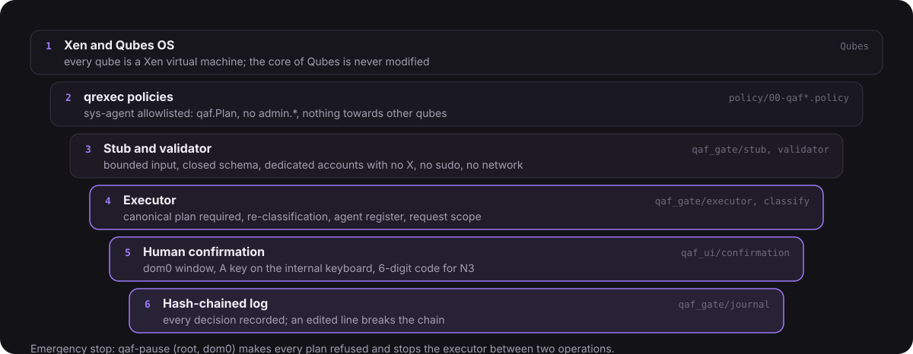
</p>

还有一个紧急停止：在 dom0 中运行 `sudo qaf-pause`，所有计划都会被拒绝，执行器会在两项操作之间停下。

### QAF 不承诺的事

- **`sys-agent` 有网络**（经由 sys-firewall）：它读网页和文档。这是有意为之，因为它本来就被当作“受影响”：任何 N2 及以上的操作都会先问你。
- **你的请求会发送给模型的服务商，除非你选择本地 AI。** 使用订阅或 API 密钥时，你的请求和智能体读到的内容都会经过 Anthropic（或其他服务商）的服务器。你也可以运行本地模型：Claude Code 可以指向兼容的服务器（`ANTHROPIC_BASE_URL` 变量，例如 Ollama，或 LiteLLM 这类中转），放在另一个 qube 或你自己的另一台机器上，这样你的请求就不会离开你的设备。隐私更好，但本地模型通常能力较弱，而且项目尚未测试这种搭配。选择权在你：QAF 的安全不依赖于模型，无论用哪个模型，Doorman 都执行同样的规则。
- **可以免除确认**，由你决定（`qaf-suspendre 15m|1h|1j|permanent`，类似 Omarchy 的免密码 sudo）。免确认期间，本需确认的操作不弹窗直接通过，并记入日志；**N4 仍然拒绝**，而紧急暂停优先。不属于 root 或可被他人修改的免确认文件会被忽略。
- **没有做过外部审计。** 唯一的安全审查是项目自己做的。

**发现漏洞？** 请勿在公开的 issue 中报告：报告方式以及哪些情况算作漏洞，见 [`SECURITY.md`](SECURITY.md)（法文在前，英文在后）：通过 GitHub 的私密漏洞报告提交。

## 安装

适用于正常安装、带有模板 `debian-13-xfce` 的 **Qubes OS 4.3**。QAF 的桌面是 Qubes 官方的 KDE Plasma（X11）（`sudo qubes-dom0-update kde-settings-qubes`），保留原有的 Qubes 菜单：QAF 只在其中加入智能体组件（任务栏图标、提问框、智能体面板、确认窗口），不加任何键盘快捷键。没有 Plasma 也能安装 QAF；确认窗口、提问框和智能体面板在 Xfce 下同样可用。预计需要 20 到 40 分钟和 20 GiB 可用空间。

界面跟随 dom0 会话的语言，与 Plasma 一致（先看 `LANGUAGE`，再看 `LC_ALL`、`LC_MESSAGES`、`LANG`）：以 `en` 开头为英语，以 `zh` 开头为简体中文，否则为法语。要把 QAF 切换为中文：在 Plasma 的系统设置中打开“语言和区域”，把简体中文排在最前，然后注销并重新登录。中文显示使用 dom0 自带的 Noto Sans CJK SC 字体。

目前还没有正式发布的版本：归档 `qaf.tar.gz` 用 `tools/make-dist.sh` 从本仓库构建，它也会显示归档的指纹。

```bash
# 在 dom0 中：从存放归档的 qube 取来归档，然后校验
qvm-run --pass-io personal 'cat ~/Downloads/qaf.tar.gz' > ~/qaf.tar.gz
echo "指纹  qaf.tar.gz" | sha256sum -c

# 唯一的一条命令
cd ~ && tar -xzf qaf.tar.gz
sudo bash qaf/tools/qaf-installer ~/qaf.tar.gz 指纹
```

安装程序在做任何改动之前先检查前提条件，显示它的计划，部署 Doorman，创建 `tpl-agent` 和 `sys-agent`、用于工作的一次性 qube、安全设置，最后对原有的 Qubes 做一次无回归检查。它不修改 Qubes 或 KDE 自带的任何文件：只添加自己的文件。

```bash
qaf-installer --verifier            # 检查原有 Qubes 无回归，只读
sudo qaf-installer --retour         # 移除一切，保留已创建的 qube
sudo qaf-installer --retour --purge # 连已创建的 qube 也一并移除
```

之后只剩一步：在 `sys-agent` 中连接 Claude Code（点任务栏中的智能体图标，再选 Claude）。完整的使用说明、指纹、可能的错误和卸载方法见 [`docs/INSTALLATION.md`](docs/INSTALLATION.md)（法语）。

## 项目状态

QAF 是一个**原型**，始于 2026/10/25，只在**一台机器**（Lenovo Legion 82JU，Qubes OS 4.3.2）上开发和试用。

**已经可用、并在真实机器上试过的**：

- 完整的三进程 Doorman，带内置键盘确认窗口和哈希链日志；
- 从 `sys-agent` 用自然语言调用的各项操作：创建、克隆、启动、设置 qube，安装和移除软件包，更新，备份，复制文件（另加 Qubes 原生的确认），进入 qube；
- Qubes 的无回归检查，在 Doorman 运行、暂停和停止三种状态下；
- 一条命令完成安装，适用于正常安装的 Qubes 4.3。

**测试**：2 800 多个自动化测试（2026/10/29 通过 2 848 个），运行在模拟的 Qubes 后端上。其中有注入测试套件：被操纵的智能体可能伪造的每一个计划，结局都是被拒绝或进入 dom0 的确认窗口，绝不会被直接执行。

**尚未完成：**

- 没有正式发布的版本，也没有签名的 RPM 包：只有一个归档和它的指纹，需要手动校验；
- 只有一个智能体（Claude Code）；Codex 等已在计划中；
- 安装模板仍需你自己用 Qubes 的工具完成（N4）；
- 只在一台机器上试过：换一台机器，可能会遇到意外；
- 没有外部审计。

## 代码仓库

公开地址：<https://github.com/ponthieutheo/qaf>（`git clone https://github.com/ponthieutheo/qaf.git`）。

```text
qaf_gate/    Doorman（dom0，TCB）
qaf_mcp/     智能体的 MCP 服务器（sys-agent）
qaf_hand/    目标 qube 中的服务
qaf_ui/      桌面上的智能体组件：确认窗口、提问框、智能体面板（dom0），法语、英语和简体中文
policy/      qrexec 策略
packaging/   systemd 单元、账户、qaf-installer 的 Doorman 步骤
profil/      安装程序设置的安全选项
materiel/    按机型划分的配置
tools/       qaf-installer、make-dist.sh、loc.sh
tests/       pytest 测试套件和模拟后端
docs/        安装、故障排除、展示用图片
```

测试：`uv run --python 3.12 pytest -q`（在 Linux 或 WSL 下）。TCB 的规模：`tools/loc.sh`。

## 许可证

[GPL-2.0-or-later](LICENSE)。取自第三方项目的元素（Lucide 的图标路径，ISC 许可证）：[`LICENCES-TIERS`](LICENCES-TIERS)。

<p align="center">
  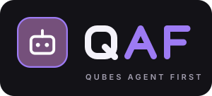
</p>
